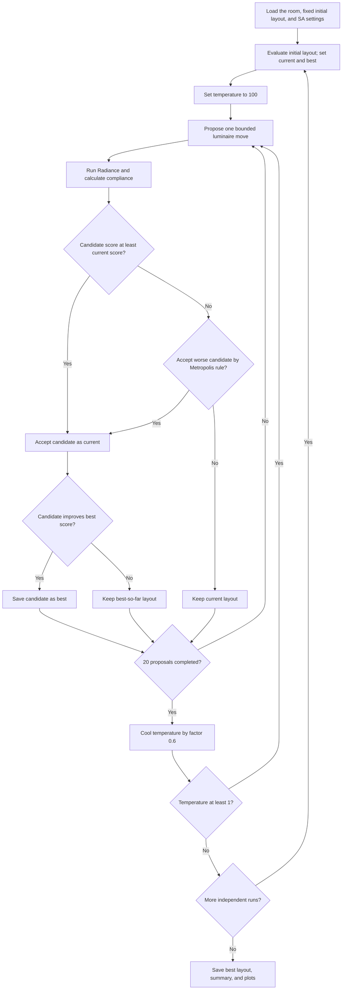
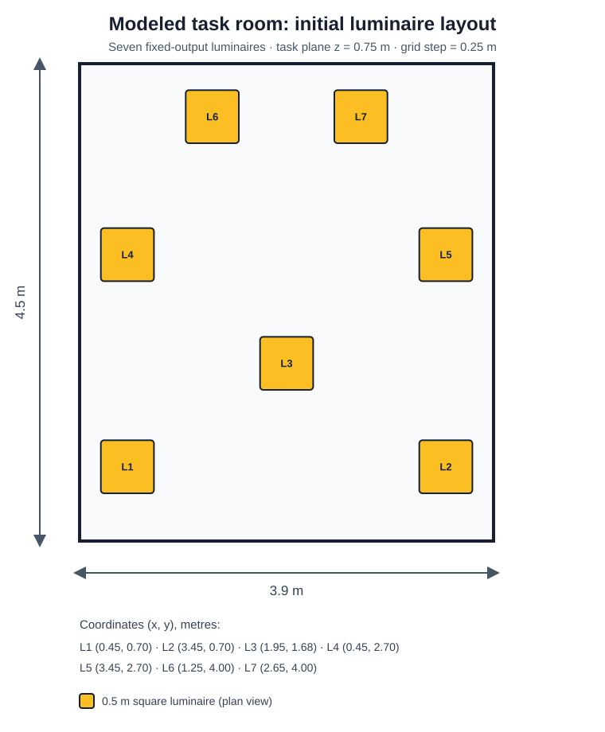
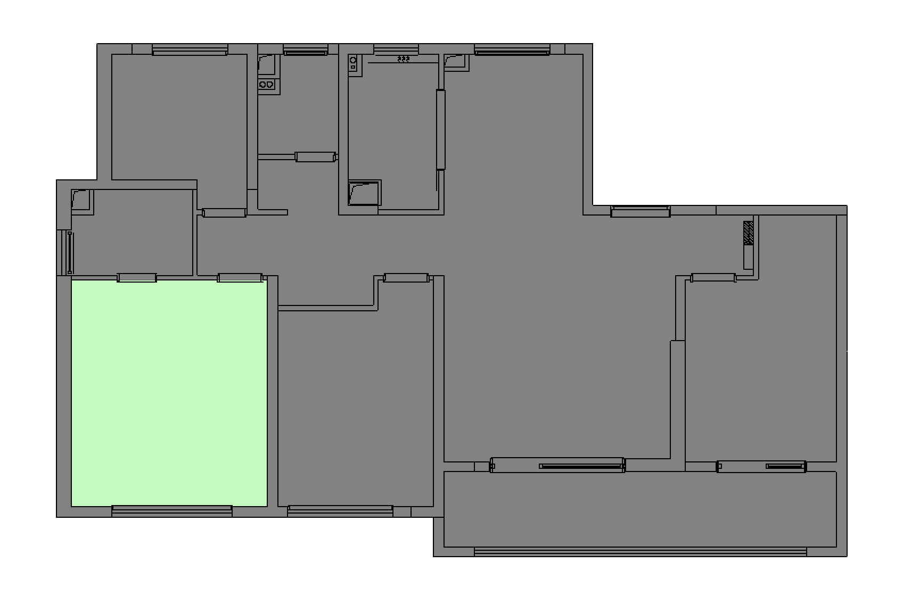

# Indoor Lighting Layout Optimization with Simulated Annealing

An implementation of the residential lighting layout case study in Jingren Fang, *An Algorithm for Indoor Lighting Layout Optimization Using Simulated Annealing* (2025). The repository separates the Radiance lighting model, compliance objective, simulated annealing search, and plotting code so the study can be inspected and rerun.

> **Reproduction status:** the paper reports an increase in illuminance compliance from approximately 63% to over 80%. That is the paper's reported result, not a result reproduced in this repository yet. The original Radiance executable is not bundled; a local Radiance installation is required to run the full case.

## Project Overview

The case study searches the positions of seven fixed-output luminaires in a 4.5 m × 3.9 m × 3.0 m room. Radiance calculates task-plane illuminance at 0.75 m height on the paper's 0.25 m sampling grid. Simulated annealing perturbs the layout and seeks to increase the fraction of sampled points within the 90–200 lux target band.

The supplied paper describes the method as balancing energy use and visual comfort. Its formal objective, however, is the fraction of the task plane in the qualified illuminance range. The provided implementation keeps the number, luminous flux, and size of luminaires fixed; it does not directly optimize energy use or luminaire count. Accordingly, this code reports compliance and does not claim an energy reduction.

## Research Background

The paper motivates layout optimization as a way to improve lighting quality while reducing over-lighting. It describes Radiance-based point illuminance evaluation followed by an SA search. The paper reports that its case study's compliance rate rose from about 63% in the original arrangement to above 80% after optimization.

## Optimization Problem Formulation

Let a candidate layout be represented by the horizontal coordinates of the seven luminaires. For each sampled task-plane point *i*, Radiance produces illuminance *Eᵢ* in lux. Define an indicator for the qualified band:

$$
q_i = \begin{cases}
1, & 90 \le E_i \le 200\;\text{lux},\\
0, & \text{otherwise}.
\end{cases}
$$

For the uniform rectangular grid used by the source code, the implemented objective is:

$$
F(\mathbf{x}) = \frac{1}{N}\sum_{i=1}^{N}q_i,
\qquad \max_{\mathbf{x}} F(\mathbf{x}).
$$

The manuscript writes the equivalent area ratio, *A*qualified/*A*total. Since the grid is uniform, the sampled-point fraction is the discrete estimator used here. The task plane covers *x* = 0 to 3.9 m, *y* = 0 to 4.5 m, at *z* = 0.75 m and 0.25 m spacing. In the source-style inclusive grid, that is 304 sample points.

### Mathematical Model

The room geometry and material reflectances follow the supplied source: wall reflectance 0.6, floor reflectance 0.3, and seven 0.5 m square luminaires with 466 lm per RGB channel in the Radiance light definition. The initial coordinates are the fixed values in `configs/default.json`. Three pairs are mirrored across the 3.9 m room width; one luminaire is unpaired.

The paper derives the lower illuminance bound as 90% of a 100 lux standard and describes deriving the upper bound from a lighting power density limit, using 100 lm/W efficacy, utilization factor 0.7, and maintenance factor 0.8. The code uses the resulting 90–200 lux interval directly. The source's RGB-to-lux conversion is `179 * (0.265 R + 0.670 G + 0.065 B)`.

## Simulated Annealing Algorithm

One move shifts either one mirrored pair together or the unpaired luminaire. Each x/y shift is sampled uniformly in ±0.4 m, then clipped to the room bounds. Temperature starts at 100, cools by 0.6, and stops after dropping below 1.0. There are 20 proposals per temperature stage and five independent runs, as stated in the paper. The initial luminaire arrangement is fixed by the supplied experimental code rather than randomized.

Because the objective is maximized, an improving or equal candidate is accepted; a worse candidate is accepted with the Metropolis probability:

$$
P(\text{accept}) = \exp\!\left(\frac{F_{new}-F_{current}}{T}\right),
\quad F_{new}<F_{current}.
$$

The best-so-far layout is retained independently of the current SA state.



## Objective Function

`compliance_rate()` returns the inclusive fraction of samples with illuminance from 90 through 200 lux. This score is maximized. A point outside the band is treated as non-compliant whether it is under-lit or over-lit; no separate penalty weights are applied.

## Constraints

- Room dimensions, materials, luminaire flux and size, task-plane height, and sampling interval are fixed in the case configuration.
- Luminaire x/y coordinates are clipped to the modeled room bounds.
- The first, fourth, and sixth source-order luminaires move with their width-mirrored partners; the third luminaire is moved independently.
- Luminaire count and output are fixed. No energy or lamp-count decision variable is present.
- The model does not encode furniture, daylight, occupancy, glare, or task-specific subregions.

## Project Structure

```text
.
├── README.md
├── requirements.txt
├── configs/default.json
├── docs/
│   ├── paper.pdf
│   └── reproducibility-notes.md
├── src/lighting_optimization/
│   ├── lighting/         # room model and Radiance interface
│   ├── optimization/     # compliance objective and SA
│   └── visualization/    # illuminance and convergence plots
├── scripts/run_optimization.py
├── results/
│   ├── apartment_layout.png  # full supplied apartment plan
│   └── modelled_room.svg     # room and default luminaire layout
├── tests/test_core.py
└── archive/original/     # supplied Python source snapshots
```

`archive/original/` preserves the supplied Python source and an earlier source revision. Radiance executables and the unrelated bundled Radiance distribution are not copied into this repository.

## Installation

Use Python 3.10 or newer. Matplotlib is installed from `requirements.txt`. Radiance is a separate command-line application, not a Python package; the GitHub Actions workflow downloads the Linux release from the [official LBNL Radiance releases](https://github.com/LBNL-ETA/Radiance/releases/latest) and configures `oconv`, `rtrace`, and `RAYPATH` for the job. For local runs, install Radiance using the [official installation instructions](https://www.radiance-online.org/download-install/installation-information) and make `oconv` and `rtrace` available on `PATH`.

```bash
python -m venv .venv
source .venv/bin/activate          # Windows: .venv\Scripts\activate
python -m pip install -r requirements.txt
```

## Usage

From the repository root:

```bash
python scripts/run_optimization.py
```

The default configuration runs five independent cycles, each with 20 proposals per temperature stage, and saves `summary.json`, `convergence.png`, and `best_illuminance.png` under `results/run/`. To run one cycle while checking a Radiance installation:

```bash
python scripts/run_optimization.py --runs 1
```

Use another JSON file with `--config path/to/config.json`, or choose an output folder with `--output-dir path/to/results`.

The full default run performs roughly 1,000 candidate illuminance simulations plus initialization/final evaluations. Radiance runtime depends on the local installation and machine.

## Example Results

| Source | Initial compliance | Optimized compliance | Status |
|---|---:|---:|---|
| Paper case study | ~63% | >80% | Reported by the paper; not independently reproduced here |
| Refactored repository | — | — | Run with Radiance to produce new measurements |

## Visualization

The model diagram below is drawn from `configs/default.json` and shows the seven initial luminaire positions in the 3.9 m × 4.5 m room used by Radiance. The full apartment drawing is included for context; its green-highlighted room is the modeled area. New optimization runs generate a point-sampled lux map and a best-score convergence plot.



*Initial layout from the default configuration. Coordinates are in metres; the calculation task plane is at 0.75 m.*



*Full apartment context supplied with the project files; the highlighted room corresponds to the rectangular Radiance model above.*

## Dependencies

- Python standard library
- Matplotlib (figures)
- Radiance command-line tools `oconv` and `rtrace` plus the Radiance library path `RAYPATH` (external simulation engine; installed in GitHub Actions from the official LBNL release)

The refactored numeric objective and simulated annealing core use only the Python standard library. NumPy, SciPy, OpenCV, and a separate interpolation stack are not required.

## Verification

Run the dependency-free core checks from the repository root:

```bash
PYTHONPATH=src python -m unittest discover -s tests -v
```

These checks cover threshold inclusivity, sample-grid size, non-mutating mirrored perturbations, and best-so-far SA tracking. They do not validate Radiance rendering; that requires an installed Radiance toolchain and a full run.

## References

1. Fang, J. (2025). *An Algorithm for Indoor Lighting Layout Optimization Using Simulated Annealing*. SSRN working paper 5523359. [Paper page](https://ssrn.com/abstract=5523359). DOI: [10.2139/ssrn.5523359](https://doi.org/10.2139/ssrn.5523359).
2. Kirkpatrick, S., Gelatt, C. D., & Vecchi, M. P. (1983). Optimization by simulated annealing. *Science, 220*(4598), 671–680.
3. Ward, G. J. (1994). The RADIANCE lighting simulation and rendering system. In *Proceedings of SIGGRAPH '94*, 459–472.
4. GB/T 50034, *Standard for Lighting Design of Buildings*, referenced in the paper for task-plane illuminance criteria.
5. The supplied paper's remaining references are preserved in `docs/paper.pdf`.
